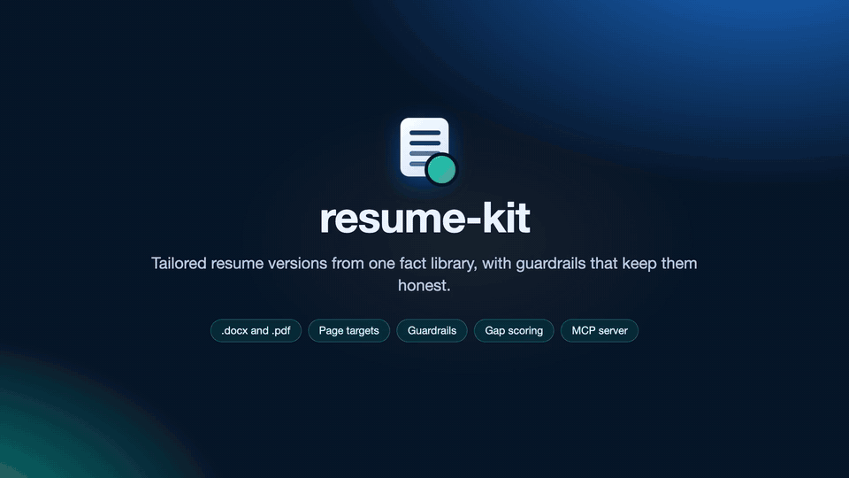

# resume-kit

**Tailored resume versions from one fact library, with guardrails that keep them honest.**

[](docs/resume-kit-demo.mp4)

You keep every confirmed fact about your career in one file. Each job gets a short version file that picks and orders those facts, with its own headline and summary. resume-kit renders a version to `.docx` and `.pdf`, checks that it hits your page target, and won't build anything that breaks one of your guardrails: claims you've ruled out, or facts that must always appear. It can also score a version against a job posting with [shortlist-ai](https://github.com/vinayvobbili/shortlist-ai), the way a screener would read it. All of this is also an MCP server, so an AI assistant can tailor, build, and score resumes for you without making things up.

## Why

Tailoring a resume for every job tends to produce a dozen near-copies that drift apart. A number gets corrected in one copy but not the others. A claim you walked back reappears. Page 3 appears without anyone noticing. With resume-kit:

- **Each fact lives in one place.** Versions refer to facts by id and never restate them, so a correction reaches every version.
- **Guardrails fail the build.** `guardrails.yaml` lists claims that must never appear (with the reason) and facts that must. They're checked on every build, which also makes it safe to let an AI assistant write versions.
- **The page count is checked.** The build fails unless the PDF hits its target, and it prints the text that spilled over.
- **Gaps get sorted.** `resume score` lists the must-haves a posting asks for that the resume doesn't show. A gap that matches a guardrail is labeled as a real gap, not a wording problem to paper over.

## Setup

```sh
git clone https://github.com/vinayvobbili/resume-kit && cd resume-kit
python3 -m venv .venv && .venv/bin/pip install -e '.[dev]'
npm install                                          # docx-js, used by the renderer
brew install --cask libreoffice && brew install poppler   # PDF conversion and page checks
```

Try it on the bundled example (a fictional candidate):

```sh
resume --content examples/content build --all --out /tmp/resumes
```

## Your content

Content lives outside this repo, so your personal data never ends up in it:

```sh
cp -R examples/content ~/resume-content                 # then replace the facts with yours
mkdir -p ~/.config/resume-kit && ln -s ~/resume-content ~/.config/resume-kit/content
```

resume-kit looks in the `--content` flag, then `$RESUME_KIT_CONTENT`, then `~/.config/resume-kit/content`, and falls back to the example (and says so). Keep `answers.yaml` out of version control.

## Commands

```sh
resume list                         # versions, the content dir in use, and applied dates
resume draft acme-sre posting.md    # draft a tailored version from a posting
resume check                        # guardrails on every version
resume build acme --preview         # -> ~/Downloads/<output>.{docx,pdf}
resume score acme                   # score against the version's posting
```

`show`, `diff`, `facts`, `trace`, `answers` and `ats` are in the [guide](docs/guide.md), along with the options a version can set (`extends`, `drop`, `undated`, `waive`, `copy_to` and more), how drafting and `since:` guardrails work, scoring backends, the MCP tools and the ATS notes.

## MCP server

```sh
claude mcp add resume-kit -s user -- /path/to/resume-kit/.venv/bin/resume-kit-mcp
```

Its instructions tell the assistant never to add unconfirmed facts, and never to "close" a gap that a guardrail marks as real.

## Tests

`pytest -m "not render"` is fast; `pytest` also renders the examples. `scripts/check` runs what CI runs. Tests only use the fictional example content.

## License

MIT
